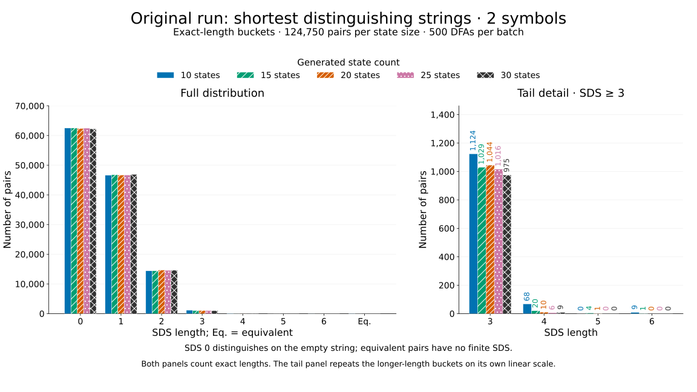
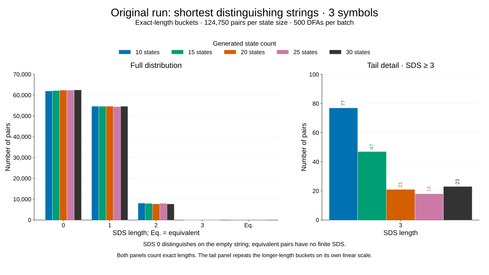
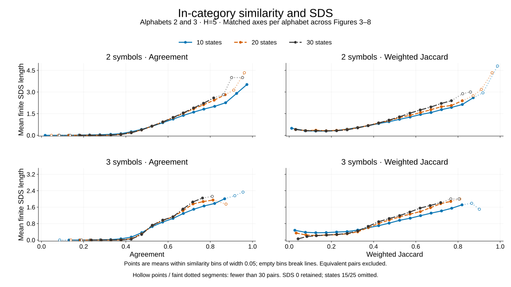
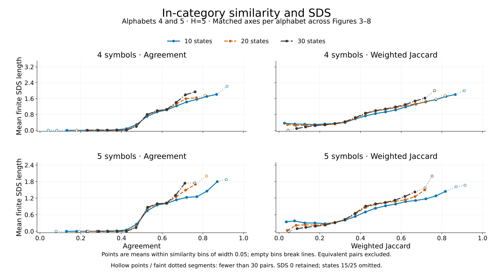
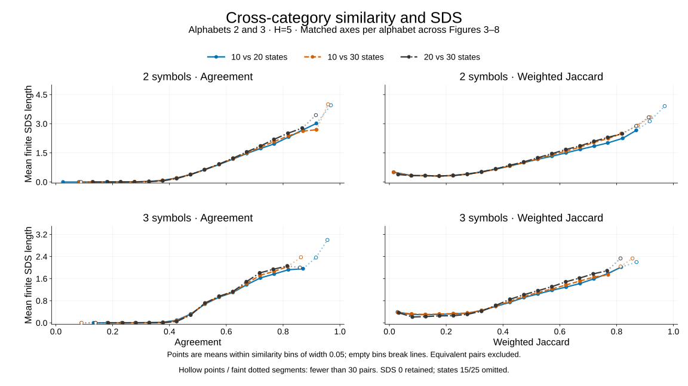
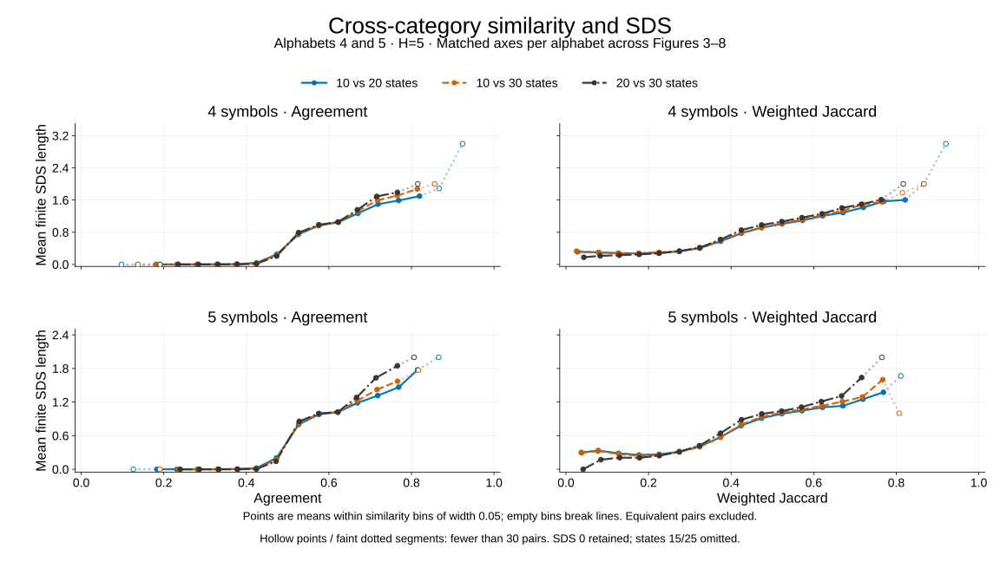
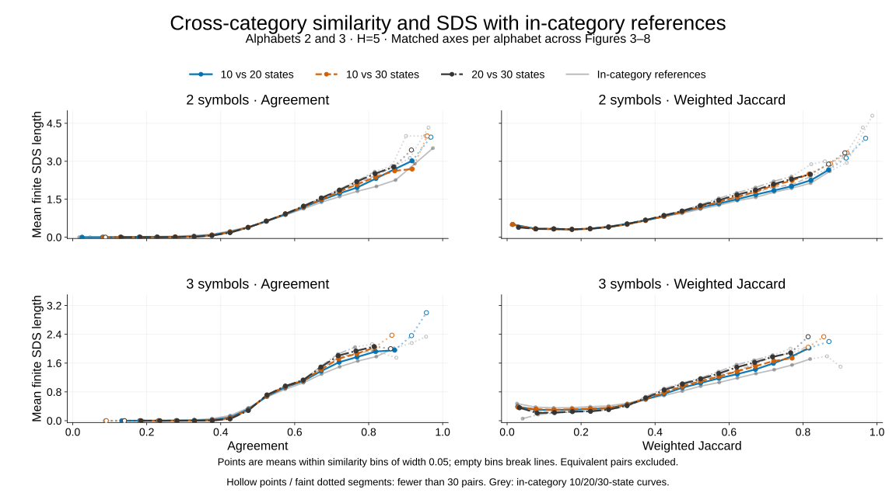
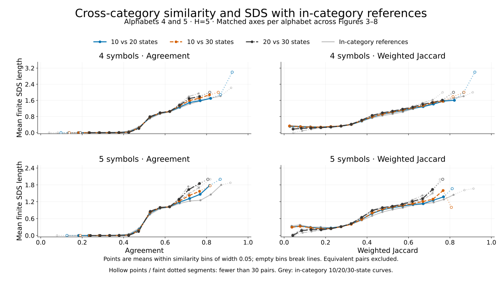
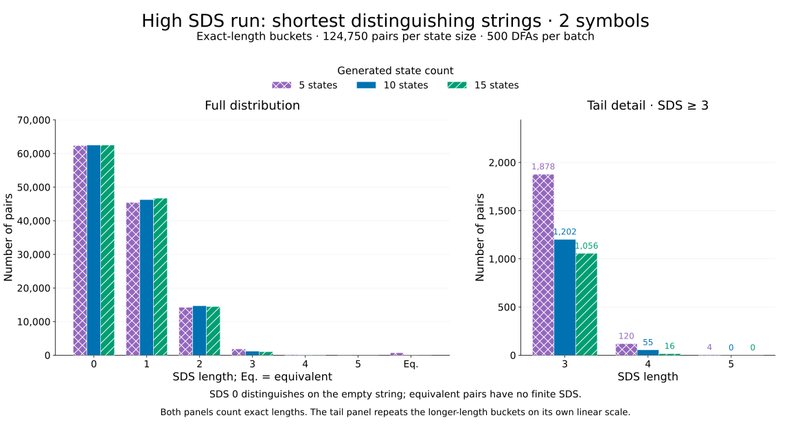
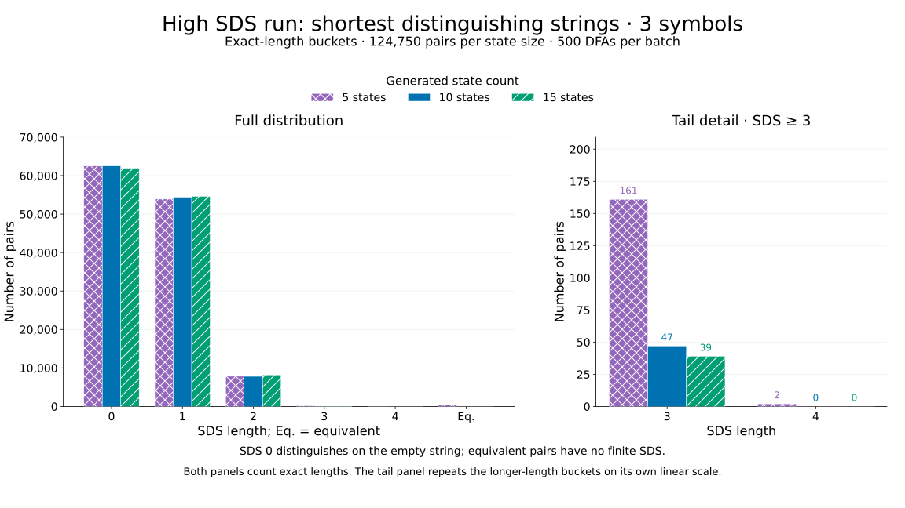

# Shortest distinguishing strings: presentation summary

Ten figures from the original and High SDS experiments. Each batch contains 500 DFAs; within-category means the same alphabet and generated state count, while cross-category means different state counts within the same alphabet.

| Experiment | Configurations | Pairs |
|---|---|---|
| Original, within-category | Alphabets 2–5 × states 10/15/20/25/30 | 2,495,000 |
| Original, cross-category | Alphabets 2–5 × 10–20 / 10–30 / 20–30 states | 3,000,000 |
| High SDS, within-category | Alphabets 2/3 × states 5/10/15 | 748,500 |

**Reading the figures:** SDS 0 is an empty-string distinction; equivalent pairs have no finite SDS. Both similarities use H=5. Similarity figures and correlations exclude equivalent pairs, retain SDS 0, and omit original states 15/25. All figures are SVGs sized for 16:9 slides.

## 1. Original SDS buckets — alphabet 2

Most pairs differ at length 0 or 1. The longest observed SDS is 6, occurring in the 10- and 15-state batches.

| States | SDS 0 | SDS 1 | SDS 2 | SDS 3 | SDS 4 | SDS 5 | SDS 6 | Equivalent | Total |
|---|---|---|---|---|---|---|---|---|---|
| 10 | 62,499 | 46,613 | 14,400 | 1,124 | 68 | 0 | 9 | 37 | 124,750 |
| 15 | 62,499 | 46,770 | 14,421 | 1,029 | 20 | 4 | 1 | 6 | 124,750 |
| 20 | 62,356 | 46,680 | 14,659 | 1,044 | 10 | 1 | 0 | 0 | 124,750 |
| 25 | 62,464 | 46,702 | 14,562 | 1,016 | 6 | 0 | 0 | 0 | 124,750 |
| 30 | 62,244 | 46,914 | 14,608 | 975 | 9 | 0 | 0 | 0 | 124,750 |

## 2. Original SDS buckets — alphabet 3

Long distinctions are rarer than with alphabet 2. The tail enlargement shows every observed bucket above length 2.

| States | SDS 0 | SDS 1 | SDS 2 | SDS 3 | Equivalent | Total |
|---|---|---|---|---|---|---|
| 10 | 61,971 | 54,625 | 8,077 | 77 | 0 | 124,750 |
| 15 | 62,139 | 54,596 | 7,968 | 47 | 0 | 124,750 |
| 20 | 62,356 | 54,649 | 7,724 | 21 | 0 | 124,750 |
| 25 | 62,304 | 54,424 | 8,004 | 18 | 0 | 124,750 |
| 30 | 62,451 | 54,576 | 7,700 | 23 | 0 | 124,750 |

**Alphabets 4 and 5:** alphabet 4 has four SDS=3 pairs, all at 10 states; alphabet 5 has no SDS above 2. The full counts, including both alphabets, are in [the bucket CSV](dataviz/figures/presentation_summary/sds_buckets.csv).

## 3. In-category similarity and SDS — alphabets 2/3

Agreement has Pearson r=0.690–0.824; Weighted Jaccard has r=0.382–0.570. Curves show binned means, and hollow markers identify sparse bins.

| Alphabet | States | Finite pairs | Agreement r | Agreement ρ | Jaccard r | Jaccard ρ |
|---|---|---|---|---|---|---|
| 2 | 10 | 124,713 | 0.690 | 0.693 | 0.436 | 0.423 |
| 2 | 20 | 124,750 | 0.746 | 0.754 | 0.483 | 0.457 |
| 2 | 30 | 124,750 | 0.755 | 0.762 | 0.512 | 0.488 |
| 3 | 10 | 124,750 | 0.743 | 0.759 | 0.382 | 0.361 |
| 3 | 20 | 124,750 | 0.807 | 0.823 | 0.551 | 0.548 |
| 3 | 30 | 124,750 | 0.824 | 0.838 | 0.570 | 0.554 |

## 4. In-category similarity and SDS — alphabets 4/5

Agreement has Pearson r=0.779–0.883; Weighted Jaccard has r=0.440–0.606. Curves show binned means, and hollow markers identify sparse bins.

| Alphabet | States | Finite pairs | Agreement r | Agreement ρ | Jaccard r | Jaccard ρ |
|---|---|---|---|---|---|---|
| 4 | 10 | 124,750 | 0.779 | 0.797 | 0.464 | 0.450 |
| 4 | 20 | 124,750 | 0.839 | 0.847 | 0.538 | 0.527 |
| 4 | 30 | 124,750 | 0.856 | 0.858 | 0.552 | 0.538 |
| 5 | 10 | 124,750 | 0.798 | 0.815 | 0.440 | 0.436 |
| 5 | 20 | 124,750 | 0.866 | 0.858 | 0.551 | 0.542 |
| 5 | 30 | 124,750 | 0.883 | 0.865 | 0.606 | 0.594 |

## 5. Cross-category similarity and SDS — alphabets 2/3

Each curve represents 250,000 cross-category pairs. The longest cross-category SDS is 5: four binary pairs at 10 vs 20 states.

| Alphabet | States | Finite pairs | Agreement r | Agreement ρ | Jaccard r | Jaccard ρ |
|---|---|---|---|---|---|---|
| 2 | 10 vs 20 | 250,000 | 0.725 | 0.732 | 0.449 | 0.436 |
| 2 | 10 vs 30 | 250,000 | 0.734 | 0.739 | 0.458 | 0.445 |
| 2 | 20 vs 30 | 250,000 | 0.750 | 0.757 | 0.497 | 0.471 |
| 3 | 10 vs 20 | 250,000 | 0.782 | 0.799 | 0.469 | 0.457 |
| 3 | 10 vs 30 | 250,000 | 0.801 | 0.817 | 0.467 | 0.452 |
| 3 | 20 vs 30 | 250,000 | 0.817 | 0.832 | 0.558 | 0.550 |

## 6. Cross-category similarity and SDS — alphabets 4/5

Each curve represents 250,000 cross-category pairs. Alphabet 4 has two SDS=3 pairs, both at 10 vs 20 states; alphabet 5 has none above 2.

| Alphabet | States | Finite pairs | Agreement r | Agreement ρ | Jaccard r | Jaccard ρ |
|---|---|---|---|---|---|---|
| 4 | 10 vs 20 | 250,000 | 0.817 | 0.831 | 0.496 | 0.488 |
| 4 | 10 vs 30 | 250,000 | 0.830 | 0.841 | 0.494 | 0.487 |
| 4 | 20 vs 30 | 250,000 | 0.849 | 0.853 | 0.542 | 0.531 |
| 5 | 10 vs 20 | 250,000 | 0.841 | 0.844 | 0.490 | 0.488 |
| 5 | 10 vs 30 | 250,000 | 0.859 | 0.854 | 0.515 | 0.514 |
| 5 | 20 vs 30 | 250,000 | 0.876 | 0.863 | 0.577 | 0.567 |

## 7. Cross-category with in-category references — alphabets 2/3

Overall mean SDS differs by at most 0.0015 symbols; across shared supported bins, weighted mean absolute differences are at most 0.0102 (largest single-bin gap: 0.3358). These bins cover at least 99.92% of each pooled finite-pair sample; sparse tails can differ more.

| Alphabet | Metric | Shared bins | Within coverage | Cross coverage | Mean abs. gap | Max abs. gap |
|---|---|---|---|---|---|---|
| 2 | Agreement | 18 | 99.97% | 99.99% | 0.0086 | 0.3358 |
| 2 | Weighted Jaccard | 17 | 99.96% | 99.98% | 0.0068 | 0.1246 |
| 3 | Agreement | 14 | 99.93% | 99.98% | 0.0102 | 0.1664 |
| 3 | Weighted Jaccard | 16 | 99.96% | 99.99% | 0.0094 | 0.1903 |

## 8. Cross-category with in-category references — alphabets 4/5

Overall mean SDS differs by at most 0.0007 symbols; across shared supported bins, weighted mean absolute differences are at most 0.0079 (largest single-bin gap: 0.2249). These bins cover at least 99.85% of each pooled finite-pair sample; sparse tails can differ more.

| Alphabet | Metric | Shared bins | Within coverage | Cross coverage | Mean abs. gap | Max abs. gap |
|---|---|---|---|---|---|---|
| 4 | Agreement | 14 | 99.96% | 99.99% | 0.0066 | 0.0643 |
| 4 | Weighted Jaccard | 16 | 99.97% | 99.99% | 0.0059 | 0.0387 |
| 5 | Agreement | 12 | 99.86% | 99.98% | 0.0078 | 0.2249 |
| 5 | Weighted Jaccard | 16 | 99.97% | 100.00% | 0.0075 | 0.1646 |

## 9. High SDS run buckets — alphabet 2

The 5-state batch contains four SDS=5 pairs and 120 SDS=4 pairs. This is a separate seed-20 sample, with all generated DFAs retained.

| States | SDS 0 | SDS 1 | SDS 2 | SDS 3 | SDS 4 | SDS 5 | Equivalent | Total |
|---|---|---|---|---|---|---|---|---|
| 5 | 62,356 | 45,446 | 14,228 | 1,878 | 120 | 4 | 718 | 124,750 |
| 10 | 62,484 | 46,282 | 14,722 | 1,202 | 55 | 0 | 5 | 124,750 |
| 15 | 62,484 | 46,722 | 14,472 | 1,056 | 16 | 0 | 0 | 124,750 |

## 10. High SDS run buckets — alphabet 3

The 5-state batch contains two SDS=4 pairs; the 10- and 15-state batches reach length 3. Equivalent pairs remain separate from the finite-length buckets.

| States | SDS 0 | SDS 1 | SDS 2 | SDS 3 | SDS 4 | Equivalent | Total |
|---|---|---|---|---|---|---|---|
| 5 | 62,491 | 53,913 | 7,846 | 161 | 2 | 337 | 124,750 |
| 10 | 62,491 | 54,399 | 7,813 | 47 | 0 | 0 | 124,750 |
| 15 | 61,924 | 54,607 | 8,180 | 39 | 0 | 0 | 124,750 |

## Methods and supporting data

- **Sampling:** original source uses seed 42; High SDS uses seed 20. Neither sample is filtered. Generated state counts include unreachable states.
- **Similarity:** sample a length uniformly from 0 through 5, then sample symbols independently and uniformly. Agreement includes joint rejection; Weighted Jaccard measures accepted-language intersection weight divided by union weight, with empty union assigned 1.
- **Curves:** fixed bins [left, right), with score 1 included in the last bin. Both coordinates are observed bin means. Empty bins break lines; bins with fewer than 30 pairs use hollow markers and faint dotted segments. Each alphabet has matching axes across Figures 3–8 and both metrics; different alphabets can have different vertical limits. No fitted regression or smoothing is used.
- **Correlations:** Pearson r and Spearman ρ use all finite-SDS pairs in each configuration, including zero; Spearman uses average ranks for ties. Pairs share DFAs, so these are descriptive associations without independence-based significance tests.
- **Overlay tables:** separately pool the three within-category state sizes and the three cross-category combinations within each alphabet. Compare bins with at least 100 finite pairs in each pool; weight absolute SDS-mean differences by the smaller pool count in each bin. Coverage is the fraction of finite pairs in those bins. Grey curves themselves remain separate 10/20/30-state references; their dash patterns match Figure 3/4. Tables compare corresponding similarity intervals, whose observed mean x positions can differ.
- **Limits:** the generator is not uniform over DFAs. Bounded similarity 1 does not establish language equivalence. The High SDS run changes both seed and state sizes and does not isolate a causal state-count effect.

| Inputs | Source ID | Results ID |
|---|---|---|
| Original within-category | `2026-11-15_19-36-35-433280_UTC` | `2026-11-15_19-55-50-157162_UTC` |
| Original cross-category | `2026-11-15_19-36-35-433280_UTC` | `2026-11-15_21-03-45-337283_UTC` |
| High SDS | `2026-11-15_21-32-55-118406_UTC` | `2026-11-15_21-33-59-533782_UTC` |

[Exact buckets](dataviz/figures/presentation_summary/sds_buckets.csv) · [Correlations](dataviz/figures/presentation_summary/correlations.csv) · [Similarity bins and counts](dataviz/figures/presentation_summary/similarity_bins.csv) · [Within/cross comparison](dataviz/figures/presentation_summary/within_cross_comparison.csv) · [Input provenance](dataviz/figures/presentation_summary/provenance.json)

Rebuild from the repository root with `python dataviz/presentation_summary.py`. This validates and summarizes saved results; it performs no new DFA comparisons.
