# DFA exploratory visualization report

Source `2026-11-15_00-36-37-375402_UTC`; H=4 `2026-11-15_17-55-16-095569_UTC`.

Validated 748,500 H=4 pairs, in six separate batches of 500 DFAs. No experiment calculations were rerun.

## Reading these results

- All analyses are descriptive. Pairs share DFAs and are dependent. No independent-pair significance tests or error bars are reported.
- Equivalent pairs have no finite SDS. Means of SDS exclude them; distribution plots explicitly retain them as a separate category.
- Accepting-state fractions use all raw states, including unreachable states. Bounded acceptance mass measures a different quantity.
- Lines show conditional means and can hide dispersion. Consult distributions, exact counts, and companion CSVs, especially in sparse bins.
- Mathematical constraint: agreement is at least min(d/5, 1) for SDS d at H=4. For d>4 both scores must equal one. This is not evidence of language equivalence.
- Generator bias and reachability/minimality limit interpretation of raw state counts; there are no cross-size pair comparisons.

## Observed batch summaries

| Alphabet | States | Finite mean SDS | Positive mean SDS | Equivalent | SDS > 4 | Mean agreement | Mean Jaccard |
|---|---|---|---|---|---|---|---|
| 2 | 10 | 0.6343 | 1.2716 | 37 | 9 | 0.5000 | 0.3052 |
| 2 | 20 | 0.6347 | 1.2690 | 0 | 1 | 0.4999 | 0.3153 |
| 2 | 30 | 0.6340 | 1.2653 | 0 | 0 | 0.5000 | 0.3170 |
| 3 | 10 | 0.5692 | 1.1311 | 0 | 0 | 0.5007 | 0.3073 |
| 3 | 20 | 0.5624 | 1.1245 | 0 | 0 | 0.4998 | 0.3309 |
| 3 | 30 | 0.5615 | 1.1243 | 0 | 0 | 0.4998 | 0.3224 |

Observed: 10 inequivalent pairs have both H=4 scores equal to one because their SDS exceeds 4. Pair IDs are exported.

## Rare long witnesses

- 2 symbols, 10 generated states: 9 pairs with SDS >=5, involving 10 DFAs: [42, 103, 167, 212, 223, 240, 410, 433, 458, 487].
- 2 symbols, 20 generated states: 1 pairs with SDS >=5, involving 2 DFAs: [50, 131].

## Focused checks

The state-count means are close, not identical. They compare separately generated batches; these are not the same DFAs with states added. No significance test treating pairs as independent is appropriate.

A useful reference model assumes independent fair accept/reject answers for each distinct word. Then P(SDS >= t) = 2^(-(1 + k + ... + k^(t-1))) and the expected SDS is about 0.632843 for k=2 and 0.562622 for k=3. There is no state-count term in that idealization. Actual finite DFAs have repeated states and dependent answers, so this explains why short-depth behavior could dominate without proving state-count invariance for this generator.

The agreement oscillation needs a plotting correction. At H=4 every binary agreement score is an integer multiple of 1/80. The old histogram used width 0.025 (=2/80) with floating-point edges. Boundary roundoff can put a boundary score in the wrong adjacent bin, producing artificial peaks and troughs. The retained histogram assigns bins by integer arithmetic, with the same nominal edges.

| Alphabet | Generated states | Bins changed by exact assignment (of 40) | Largest bin percentage change |
|---|---|---|---|
| 2 | 10 | 25 | 2.945 percentage points |
| 2 | 20 | 24 | 3.013 percentage points |
| 2 | 30 | 24 | 3.075 percentage points |
| 3 | 10 | 2 | 0.592 percentage points |
| 3 | 20 | 2 | 0.655 percentage points |
| 3 | 30 | 2 | 0.669 percentage points |

Exact score counts are retained separately, so discreteness is not hidden by the corrected histogram. The artifact is not specific to the 30-state batch.

The 10-state departures in Jaccard are worth inspecting, but SDS does not force Jaccard to increase monotonically. The table below checks whether pairs involving a DFA that accepts no sampled strings drive the dips. The exclusion is a descriptive sensitivity check, not a replacement population or a statistical test.

| Alphabet | States | SDS | Subset | Pairs | Mean agreement | Mean Jaccard |
|---|---|---|---|---|---|---|
| 2 | 10 | 3 | all | 1124 | 0.8316 | 0.6234 |
| 2 | 10 | 3 | neither_DFA_has_zero_H4_acceptance | 1064 | 0.8274 | 0.6585 |
| 2 | 10 | 3 | neither_DFA_minimal_size_1 | 1052 | 0.8261 | 0.6501 |
| 2 | 10 | 4 | all | 68 | 0.9491 | 0.2876 |
| 2 | 10 | 4 | neither_DFA_has_zero_H4_acceptance | 28 | 0.9433 | 0.6986 |
| 2 | 10 | 4 | neither_DFA_minimal_size_1 | 32 | 0.9445 | 0.6112 |
| 3 | 10 | 2 | all | 8077 | 0.7220 | 0.4755 |
| 3 | 10 | 2 | neither_DFA_has_zero_H4_acceptance | 8077 | 0.7220 | 0.4755 |
| 3 | 10 | 2 | neither_DFA_minimal_size_1 | 8077 | 0.7220 | 0.4755 |
| 3 | 10 | 3 | all | 77 | 0.8570 | 0.4472 |
| 3 | 10 | 3 | neither_DFA_has_zero_H4_acceptance | 77 | 0.8570 | 0.4472 |
| 3 | 10 | 3 | neither_DFA_minimal_size_1 | 77 | 0.8570 | 0.4472 |

For alphabet 2, 10 generated states, SDS=4: the repeated DFA cohort [203, 210, 313, 370] contributes all 6 internal pairs, with mean Jaccard 0.1093. The other 62 pairs average 0.3049. This is a concentration of related observations, not independent replication.

For alphabet 3, 10 generated states, SDS=3: the repeated DFA cohort [227, 279, 313, 340, 350, 360, 364, 426] contributes all 28 internal pairs, with mean Jaccard 0.0981. The other 49 pairs average 0.6467. This is a concentration of related observations, not independent replication.

The exported anomaly pair and DFA tables identify repeated automata, effective sizes, acceptance weights, and union/intersection weights. They support structural follow-up without adding another overview figure.

Tail dependence and acceptance composition are exploratory leads; causal explanations and population-level generalizations require further independently generated batches.

## Figure gallery

### sds vs probability of agreement

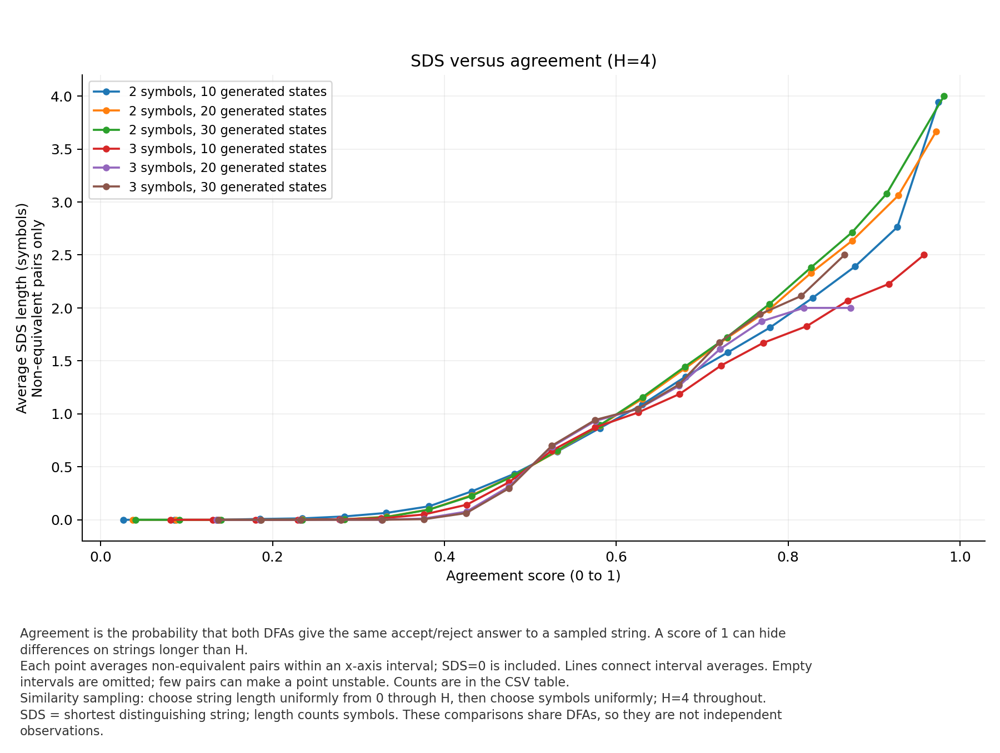

Lines connect bin means; bins with no observations are omitted. Equivalent pairs excluded. Bin counts are in the accompanying CSV; sparse tails can be unstable.

[SVG](sds_vs_probability_of_agreement.svg)

### sds vs weighted jaccard

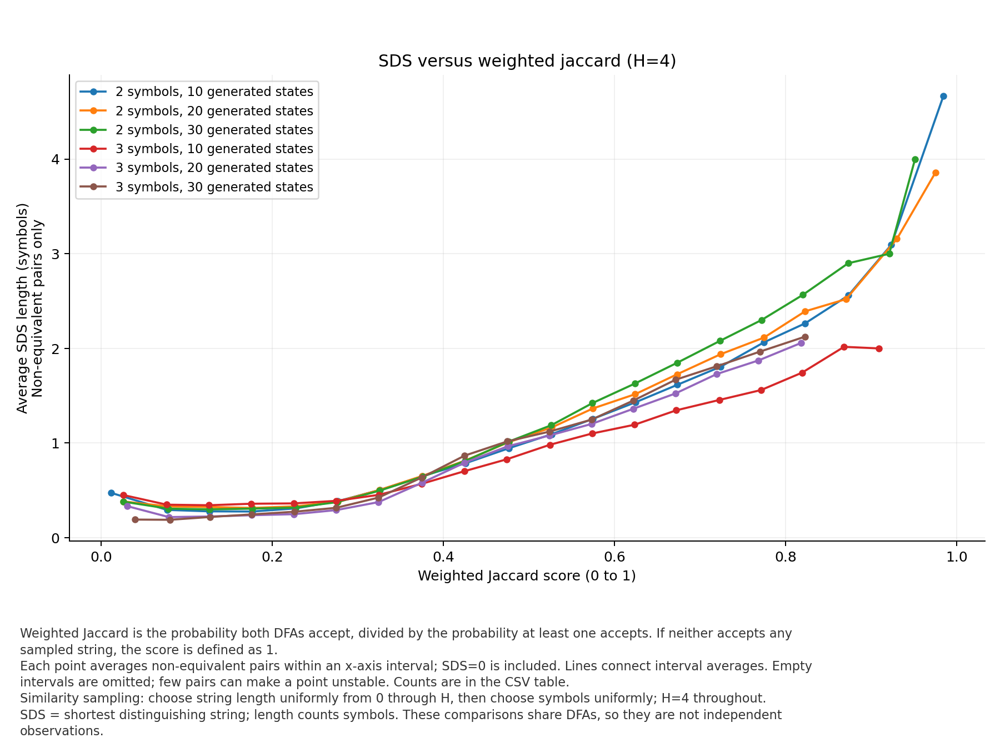

Lines connect bin means; bins with no observations are omitted. Equivalent pairs excluded. Bin counts are in the accompanying CSV; sparse tails can be unstable.

[SVG](sds_vs_weighted_jaccard.svg)

### sds vs acceptance fraction mean

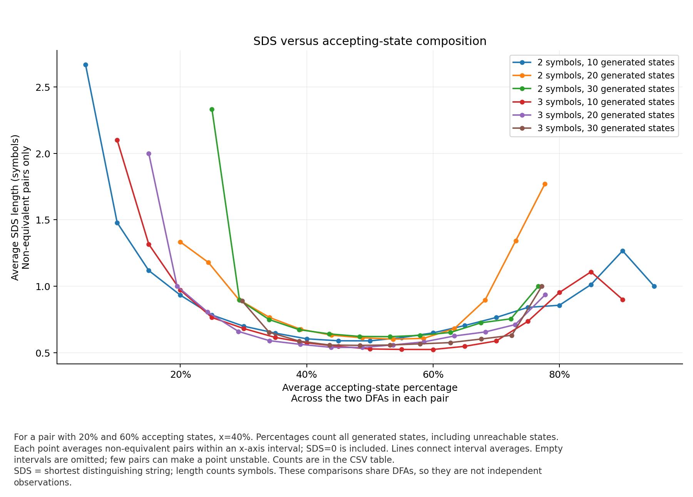

Lines connect bin means; bins with no observations are omitted. Equivalent pairs excluded. Bin counts are in the accompanying CSV; sparse tails can be unstable.

[SVG](sds_vs_acceptance_fraction_mean.svg)

### sds vs acceptance fraction gap

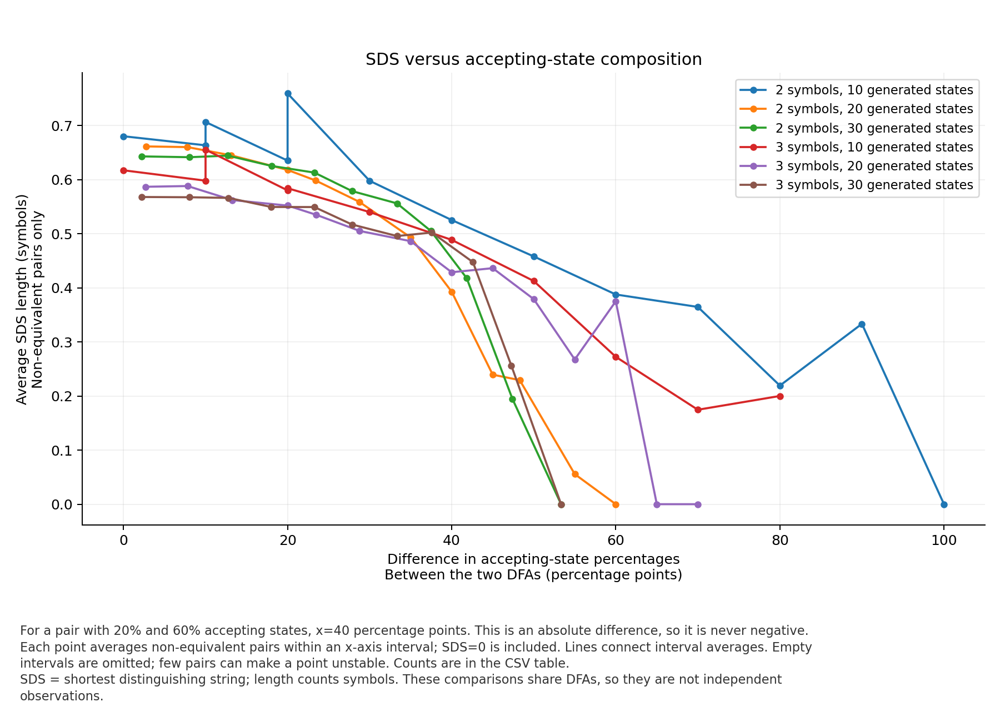

Lines connect bin means; bins with no observations are omitted. Equivalent pairs excluded. Bin counts are in the accompanying CSV; sparse tails can be unstable.

[SVG](sds_vs_acceptance_fraction_gap.svg)

### sds grouped bars

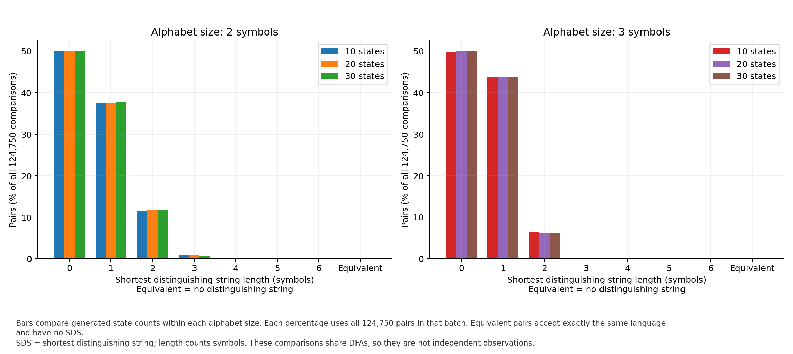

Requested grouped bars: each SDS category contains the three raw state counts. Denominator includes all 124,750 pairs per batch.

[SVG](sds_grouped_bars.svg)

### sds six distributions

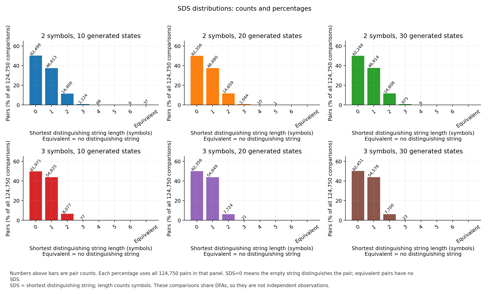

All six distributions with pair counts above bars. Equivalent means no finite SDS, and is never coded as zero.

[SVG](sds_six_distributions.svg)

### sds positive and tail

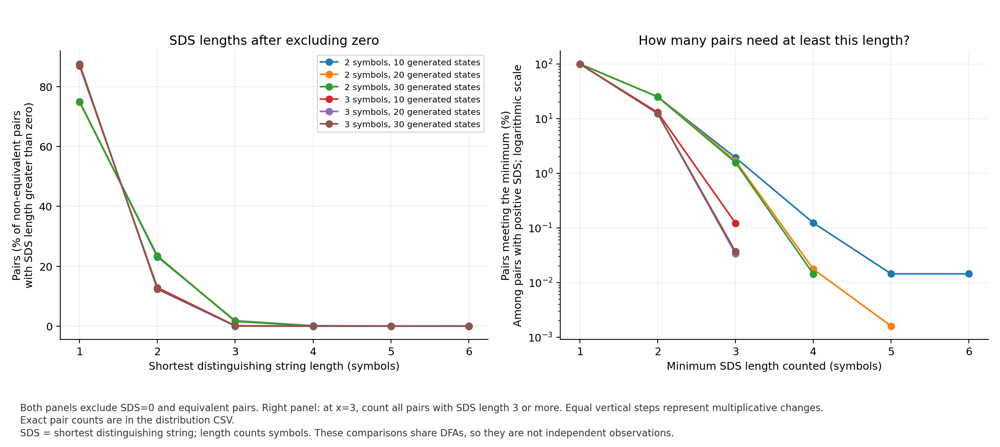

Zero lengths and equivalent pairs excluded from both denominators. The right panel shows percentages with at least the x-axis length, on a logarithmic scale. Exact counts are available in the distribution table.

[SVG](sds_positive_and_tail.svg)

### sds mean bars

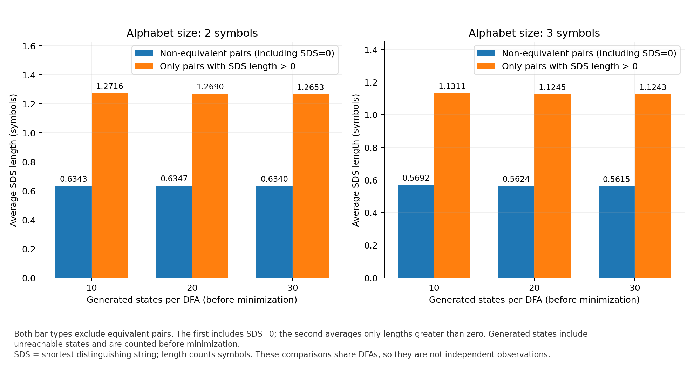

Two alphabet panels with raw state counts as bar groups; equivalent pairs excluded. No inferential error bars because pairs share DFAs.

[SVG](sds_mean_bars.svg)

### similarity joint density

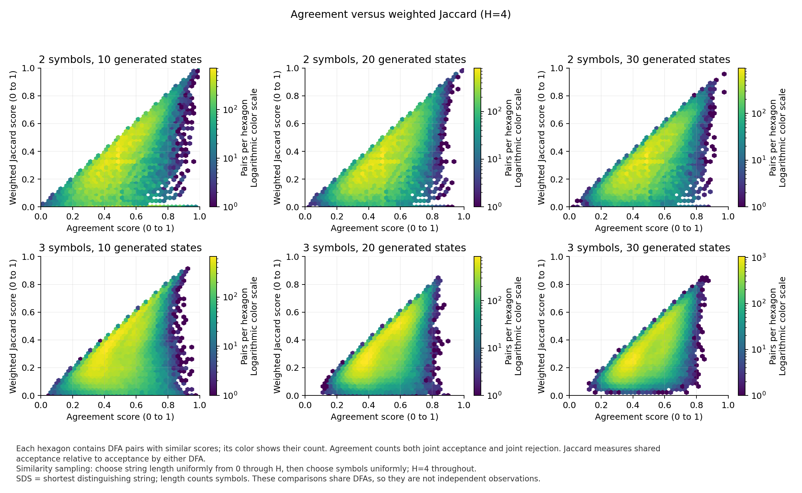

All pairs, including equivalent pairs; hexagon colors show counts on logarithmic scales. Joint rejection contributes to agreement but not to the accepted-word intersection.

[SVG](similarity_joint_density.svg)

### similarity distributions

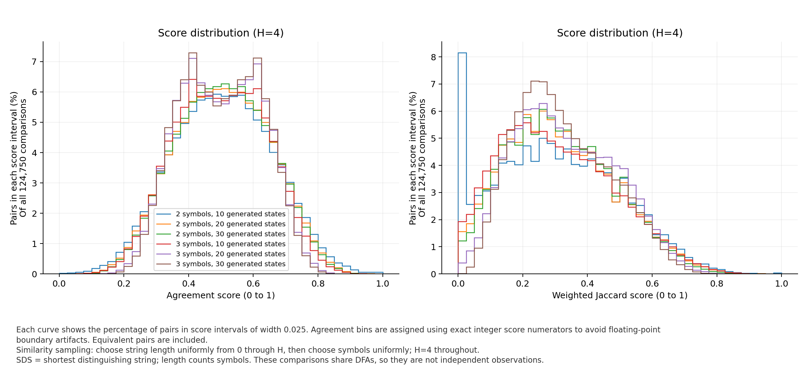

Two H=4 histograms. Agreement uses exact integer bin assignment; the earlier oscillation was sensitive to floating-point bin boundaries. See diagnostics tables for the original and corrected counts.

[SVG](similarity_distributions.svg)

### similarity by sds

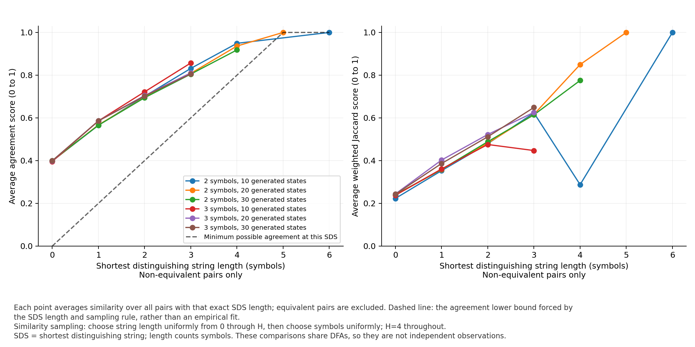

Conditional means by exact SDS; the agreement lower bound min(d/5,1) follows mathematically from uniform length sampling. An empirical trend along this bound is not independent evidence of causation.

[SVG](similarity_by_sds.svg)

### acceptance per dfa

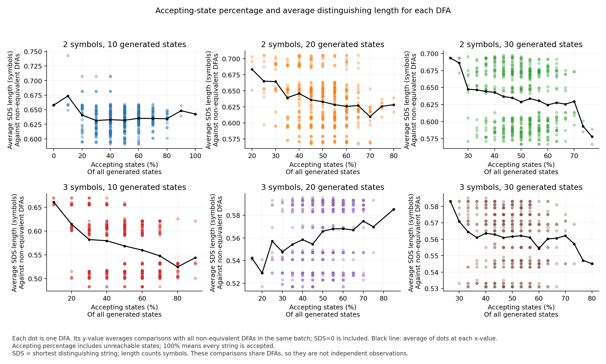

Each dot is one DFA. Its average includes comparisons with non-equivalent DFAs in the same batch, including SDS=0. The black line averages dots at each accepting-state percentage. Percentages count all generated states, including unreachable states; 100% means every string is accepted. Counts are in per_dfa.csv.

[SVG](acceptance_per_dfa.svg)

### dfa size distributions

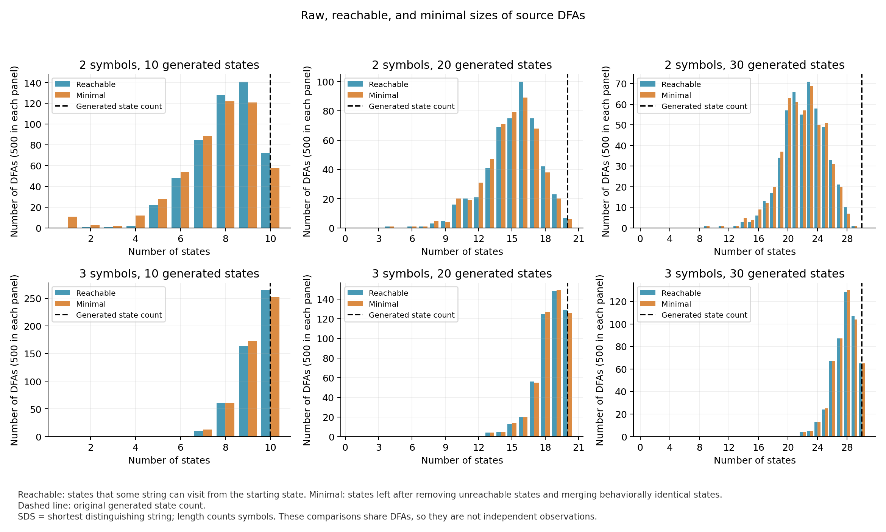

500 DFAs per panel. Raw state count overstates effective size for some generated automata; the generator is biased and these are within-batch comparisons.

[SVG](dfa_size_distributions.svg)

## Reproduction

`python dataviz/analyze.py` from the repository root. The parameter notebook can also be opened from the root or dataviz/.

All figures use full data with no random subsampling; seed is recorded for future extensions. CSV tables contain denominators and concrete pair/DFA IDs. Input hashes, package versions, and analysis hash are in provenance.json.
