# DFA exploratory visualization report

Source `2026-11-15_00-36-37-375402_UTC`; H=4 `2026-11-15_17-55-16-095569_UTC`; matched H=3 `2026-11-15_17-35-18-493520_UTC`.

Validated 748,500 pairs at each horizon, in six separate batches of 500 DFAs. No experiment calculations were rerun.

## Reading these results

- All analyses are descriptive. Pairs share DFAs and are dependent. No independent-pair significance tests or error bars are reported.
- Equivalent pairs have no finite SDS. Means of SDS exclude them; distribution plots explicitly retain them as a separate category.
- Accepting-state fractions use all raw states, including unreachable states. Bounded acceptance mass measures a different quantity.
- Lines show conditional means and can hide dispersion. Consult distributions, exact counts, and companion CSVs, especially in sparse bins.
- Mathematical constraint: agreement is at least min(d/5, 1) for SDS d at H=4. For d>4 both scores must equal one. This is not evidence of language equivalence.
- Generator bias and reachability/minimality limit interpretation of raw state counts; there are no cross-size pair comparisons.

## Observed batch summaries

| Alphabet | States | Finite mean SDS | Positive mean SDS | Equivalent | SDS > 4 | Mean agreement | Mean Jaccard |
|---|---|---|---|---|---|---|---|
| 2 | 10 | 0.6343 | 1.2716 | 37 | 9 | 0.5000 | 0.3052 |
| 2 | 20 | 0.6347 | 1.2690 | 0 | 1 | 0.4999 | 0.3153 |
| 2 | 30 | 0.6340 | 1.2653 | 0 | 0 | 0.5000 | 0.3170 |
| 3 | 10 | 0.5692 | 1.1311 | 0 | 0 | 0.5007 | 0.3073 |
| 3 | 20 | 0.5624 | 1.1245 | 0 | 0 | 0.4998 | 0.3309 |
| 3 | 30 | 0.5615 | 1.1243 | 0 | 0 | 0.4998 | 0.3224 |

Observed: 97 inequivalent pairs are indistinguishable through H=3; 10 remain indistinguishable through H=4. Matched pair IDs are exported.

## Rare long witnesses

- Alphabet 2, states 10: 9 pairs with SDS >=5, involving 10 DFAs: [42, 103, 167, 212, 223, 240, 410, 433, 458, 487].
- Alphabet 2, states 20: 1 pairs with SDS >=5, involving 2 DFAs: [50, 131].

Tail dependence and acceptance composition are exploratory leads; causal explanations and population-level generalizations require further independently generated batches.

## Figure gallery

### sds vs probability of agreement

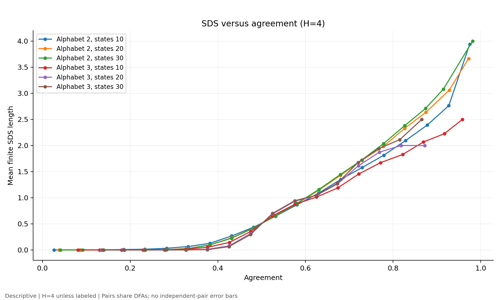

Lines connect bin means; bins with no observations are omitted. Equivalent pairs excluded. Bin counts are in the accompanying CSV; sparse tails can be unstable.

[SVG](sds_vs_probability_of_agreement.svg)

### sds vs weighted jaccard

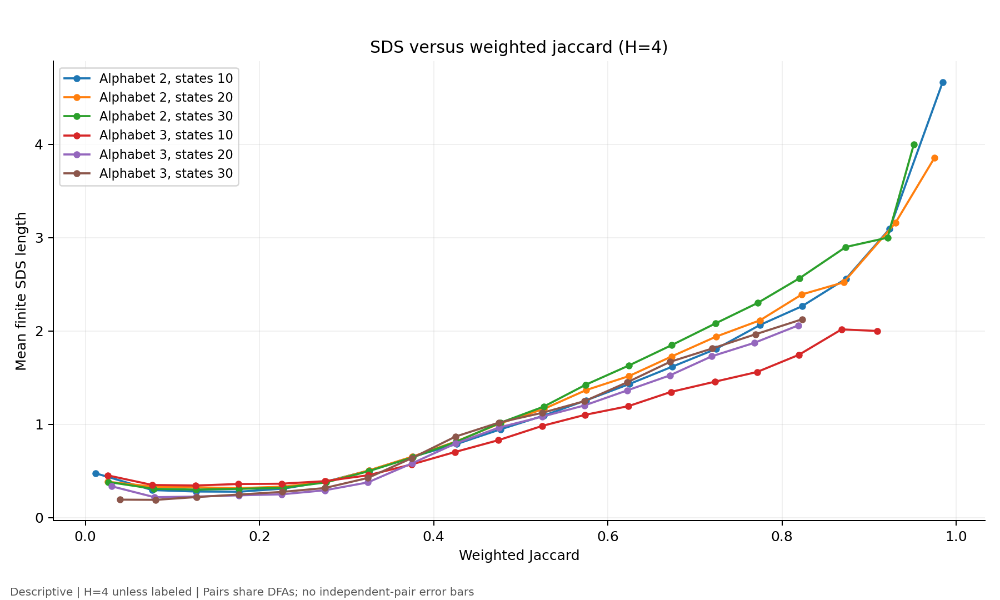

Lines connect bin means; bins with no observations are omitted. Equivalent pairs excluded. Bin counts are in the accompanying CSV; sparse tails can be unstable.

[SVG](sds_vs_weighted_jaccard.svg)

### sds vs acceptance fraction mean

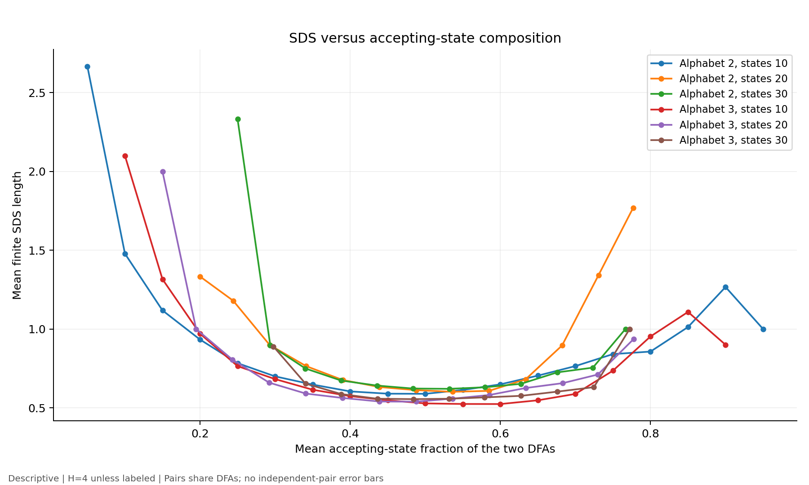

Lines connect bin means; bins with no observations are omitted. Equivalent pairs excluded. Bin counts are in the accompanying CSV; sparse tails can be unstable.

[SVG](sds_vs_acceptance_fraction_mean.svg)

### sds vs acceptance fraction gap

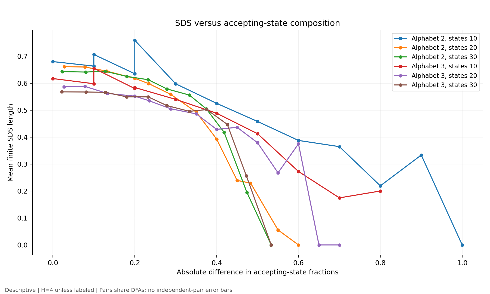

Lines connect bin means; bins with no observations are omitted. Equivalent pairs excluded. Bin counts are in the accompanying CSV; sparse tails can be unstable.

[SVG](sds_vs_acceptance_fraction_gap.svg)

### sds grouped bars

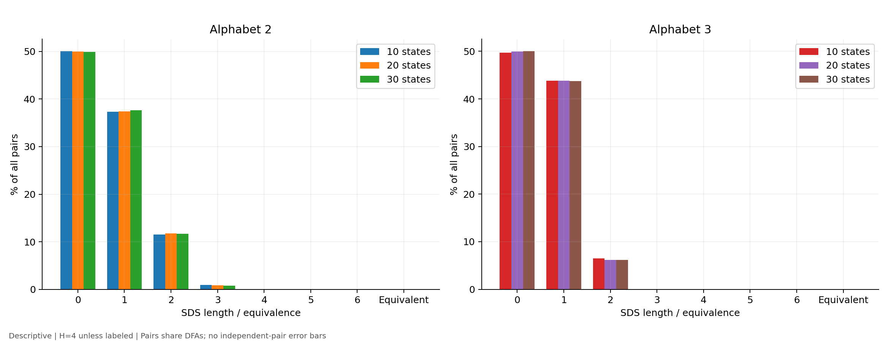

Requested grouped bars: each SDS category contains the three raw state counts. Denominator includes all 124,750 pairs per batch.

[SVG](sds_grouped_bars.svg)

### sds six distributions

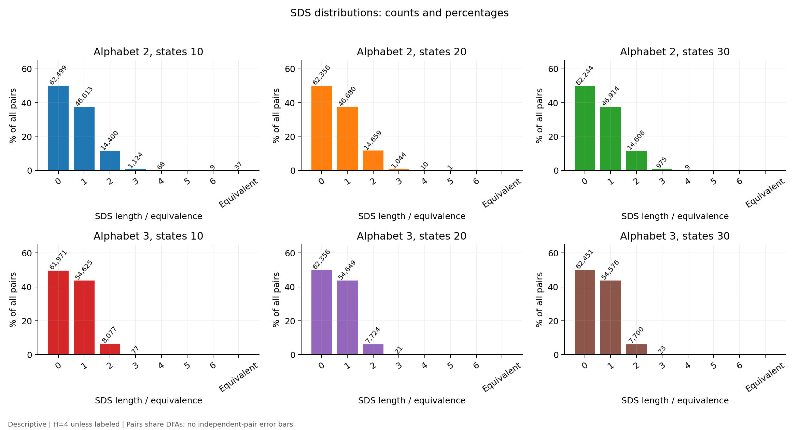

All six distributions with pair counts above bars. Equivalent means no finite SDS, and is never coded as zero.

[SVG](sds_six_distributions.svg)

### sds positive and tail

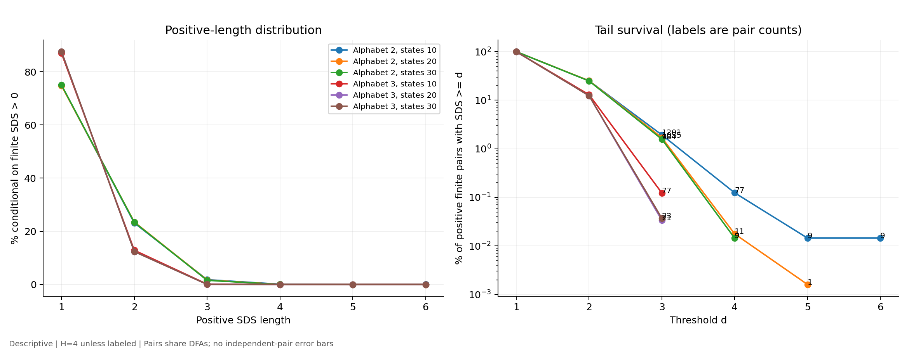

Zero lengths and equivalent pairs excluded from both denominators. Log survival reveals the rare tails; labels may overlap at nearby counts, which are available in the distribution table.

[SVG](sds_positive_and_tail.svg)

### sds mean bars

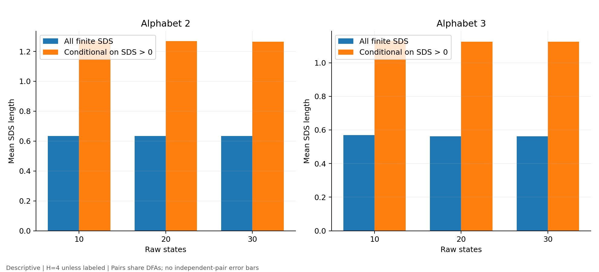

Two alphabet panels with raw state counts as bar groups; equivalent pairs excluded. No inferential error bars because pairs share DFAs.

[SVG](sds_mean_bars.svg)

### similarity joint density

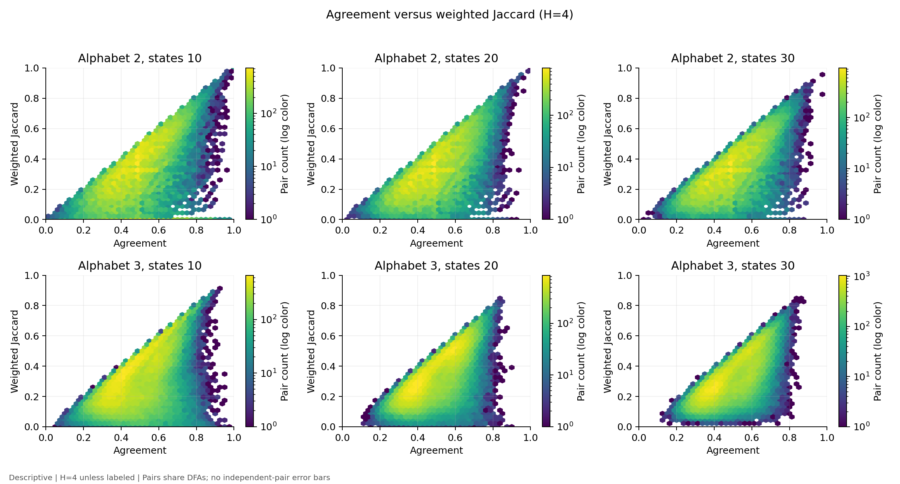

All pairs, including equivalent pairs; hexagon colors show counts on logarithmic scales. Joint rejection contributes to agreement but not to the accepted-word intersection.

[SVG](similarity_joint_density.svg)

### similarity distributions

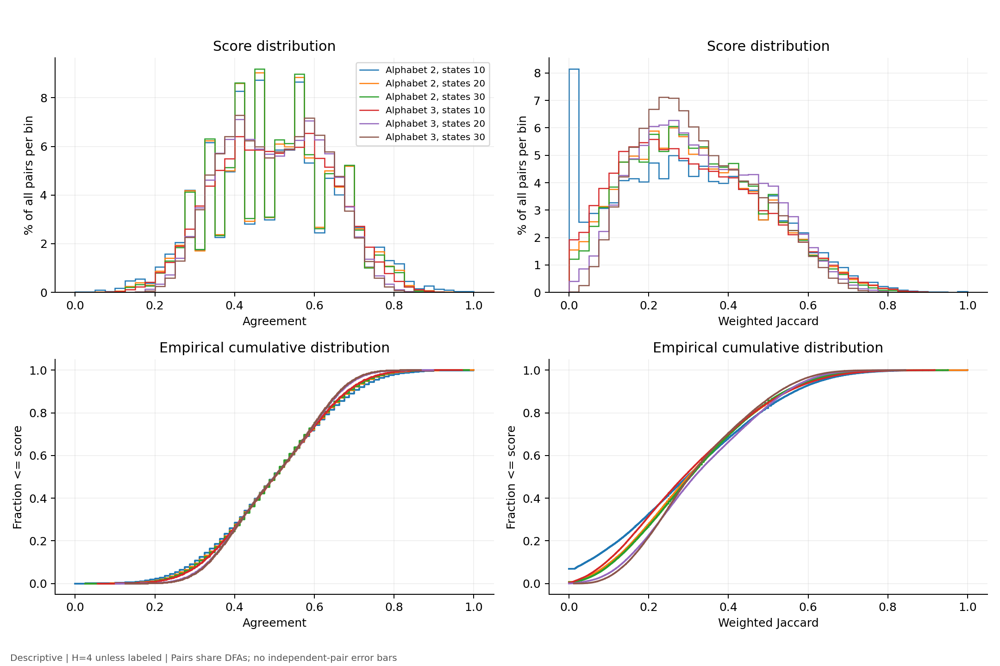

Includes all pairs. Exact zero and one counts and zero-union counts are exported in batch_summary.csv; these masses are not smoothed.

[SVG](similarity_distributions.svg)

### similarity by sds

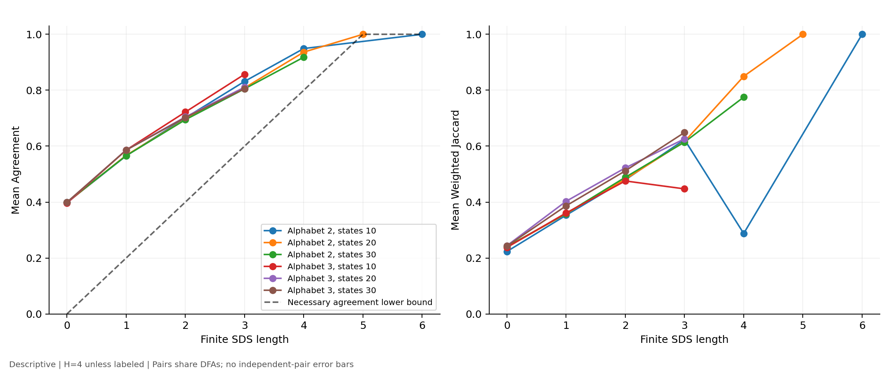

Conditional means by exact SDS; the agreement lower bound min(d/5,1) follows mathematically from uniform length sampling. An empirical trend along this bound is not independent evidence of causation.

[SVG](similarity_by_sds.svg)

### acceptance per dfa

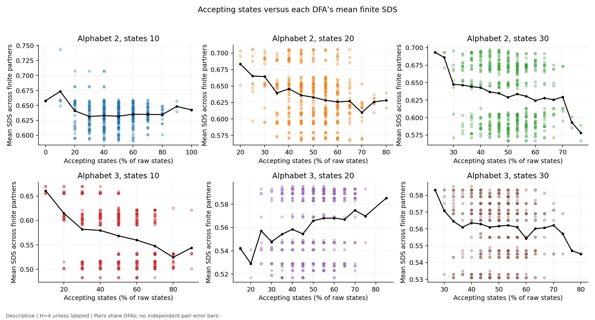

Dots are individual DFAs; black line averages DFAs at each observed fraction. Each mean uses finite partner comparisons, with counts in per_dfa.csv. These dots still share comparison outcomes.

[SVG](acceptance_per_dfa.svg)

### sds vs minimal min

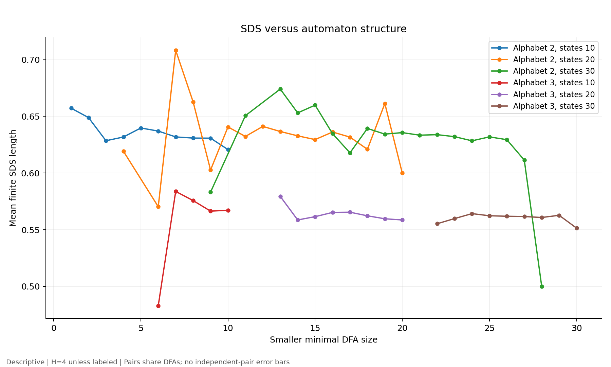

Lines connect bin means; bins with no observations are omitted. Equivalent pairs excluded. Bin counts are in the accompanying CSV; sparse tails can be unstable.

[SVG](sds_vs_minimal_min.svg)

### sds vs minimal max

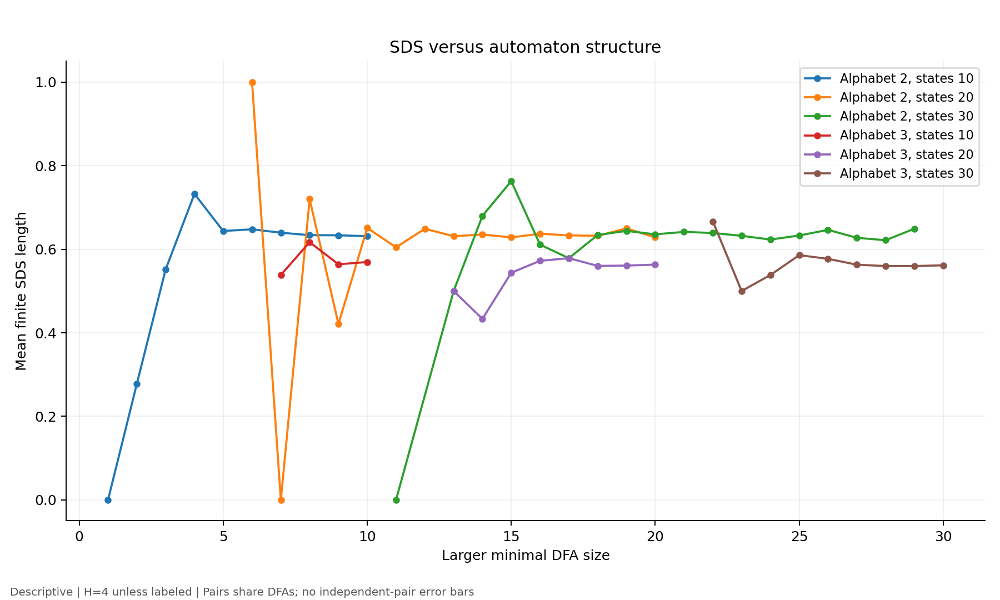

Lines connect bin means; bins with no observations are omitted. Equivalent pairs excluded. Bin counts are in the accompanying CSV; sparse tails can be unstable.

[SVG](sds_vs_minimal_max.svg)

### sds vs minimal gap

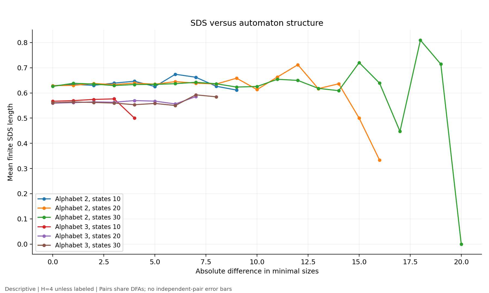

Lines connect bin means; bins with no observations are omitted. Equivalent pairs excluded. Bin counts are in the accompanying CSV; sparse tails can be unstable.

[SVG](sds_vs_minimal_gap.svg)

### sds vs unreachable fraction mean

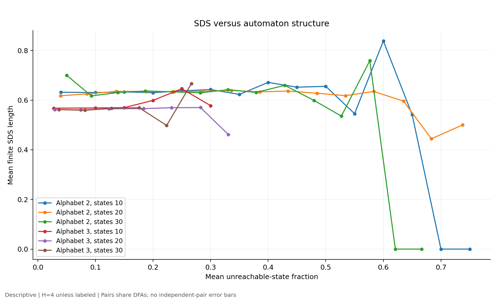

Lines connect bin means; bins with no observations are omitted. Equivalent pairs excluded. Bin counts are in the accompanying CSV; sparse tails can be unstable.

[SVG](sds_vs_unreachable_fraction_mean.svg)

### dfa size distributions

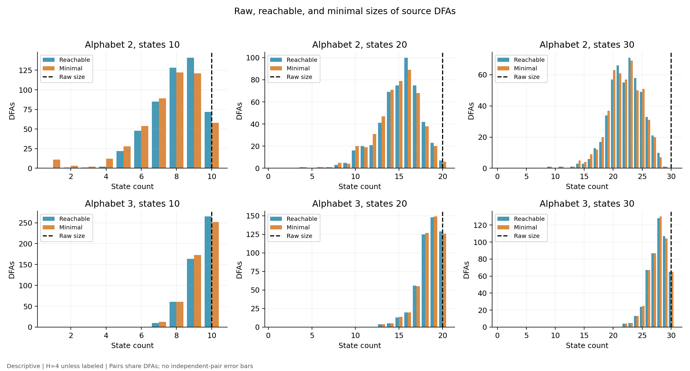

500 DFAs per panel. Raw state count overstates effective size for some generated automata; the generator is biased and these are within-batch comparisons.

[SVG](dfa_size_distributions.svg)

### matched horizon changes

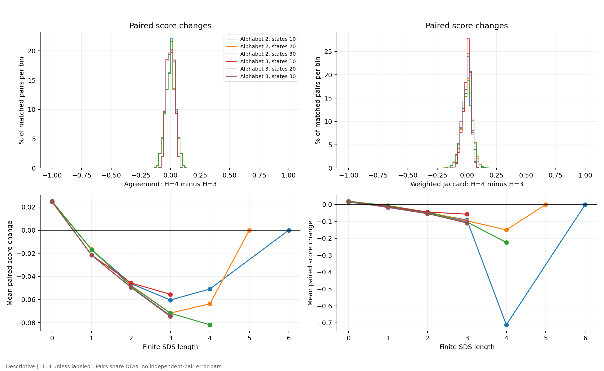

Same pair matched across runs; not independent samples. H changes both support and weights. Changes can have either sign. The full possible score-change range [-1,1] is retained, including zero-union convention changes.

[SVG](matched_horizon_changes.svg)

### horizon changes by acceptance mass

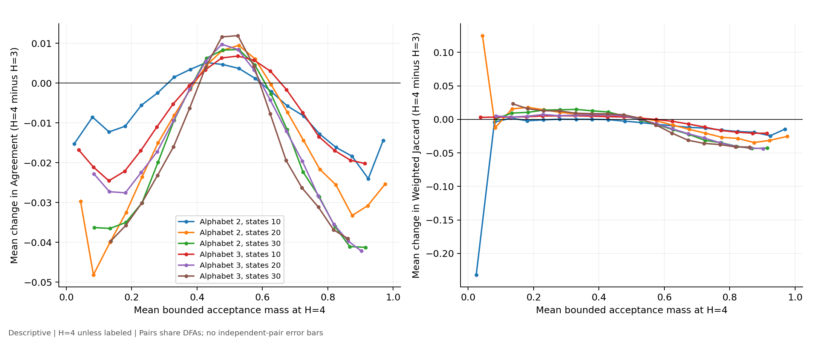

Acceptance mass is probability of accepting under the sampled word distribution; it differs from the fraction of accepting states.

[SVG](horizon_changes_by_acceptance_mass.svg)

### tail concentration

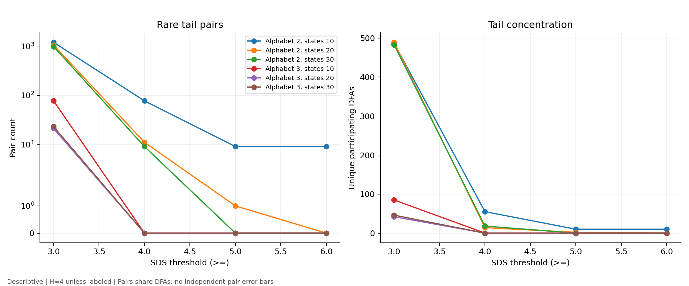

Unique DFA counts are scoped to each batch. Related tail pairs can arise from the same small group of automata; see tail_dfa_involvement.csv for IDs and effective sizes.

[SVG](tail_concentration.svg)

## Reproduction

`python dataviz/analyze.py` from the repository root. The parameter notebook can also be opened from the root or dataviz/.

All figures use full data with no random subsampling; seed is recorded for future extensions. CSV tables contain denominators and concrete pair/DFA IDs. Input hashes, package versions, and analysis hash are in provenance.json.
